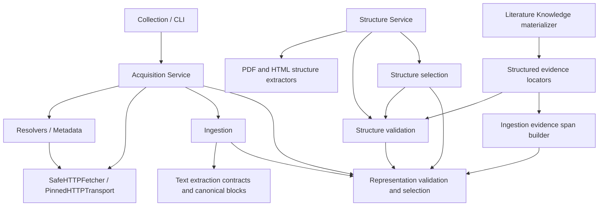

# SPC-KNOWLEDGE-01A 文献获取、导入与结构解析

审计基线为 `3f53101`。[函数迁移清单](knowledge-01a-migration-3f53101.csv) 给出 115 个函数或方法、37 个类和 10 个模块级定义的前后文件、行号及名称。最后一列标明在基线生产代码中显式导入原顶层符号的模块。方法沿用类的调用入口；该列不推断运行时选择的实现。

## 目录与调用方向

旧目录有三个实现文件 `knowledge/acquisition.py`、`knowledge/ingestion.py` 和 `knowledge/structure.py`。新目录如下，每个子包的 `__init__.py` 保留原模块导入路径。

```text
src/spc/knowledge/
    acquisition/    __init__.py  transport.py  resolvers.py  metadata.py  service.py
    ingestion/      __init__.py  pdf.py  docx.py  html.py  service.py  supplementary.py  evidence.py
    structure/      __init__.py  records.py  pdf.py  html.py  service.py  validation.py  evidence.py
    literature_text.py
    representation.py
    structure_selection.py
```

箭头表示左侧调用右侧。图中省略原有 Models 和 Repositories。



原来 Ingestion 的表示选择和证据创建会在方法内部导入 Acquisition，Structure 也经由 Acquisition 验证表示。现在三方直接使用 `representation.py`。在新解释器中导入共享表示模块不会加载三个业务包；导入 Ingestion 不加载 Acquisition 或 Structure；导入 Structure 不加载 Acquisition；导入 Acquisition 不加载 Structure。Knowledge 顶层按需解析旧公共名称。全包引用图和冷启动导入均有回归测试。

## 迁移与合并

| 功能 | 权威位置（相对 `knowledge/`） | 调用与保留的约束 |
|---|---|---|
| Safe HTTP、DNS、固定 IP 连接 | `acquisition/transport.py` | 内置 resolver、获取服务、Collection 和专家来源继续使用原 fetcher。 |
| Local PDF、DOI、Article URL 定位 | `acquisition/resolvers.py` | 保留本地 PDF 文件检查、候选顺序和资源记录；三个 resolver 的方法体与基线相同。 |
| 元数据、候选、获取记录 | `acquisition/metadata.py`、`acquisition/service.py` | Metadata 计算合并与候选来源，Service 编排获取、失败、回退和记录。 |
| PDF / DOCX / HTML 文本提取 | `ingestion/pdf.py`、`docx.py`、`html.py`，公共契约在 `literature_text.py` | 以“来源、载荷 → 规范文本和块”为共同契约。PDF 和 DOCX 接受 raw artifact 与本地路径，HTML 接受 URL 与字节并返回额外摘要。保留原 extract 方法和格式专有信息。 |
| 规范化与块身份 | `literature_text.py` 的 `canonicalize_page`、`canonical_block` | DOCX 使用原先与 PDF 共用的 Unicode、空白规则。三种 extractor 共用字节摘要、块 ID 和字符区间构造。PDF 保留页分隔符；DOCX 标明逻辑段；HTML 保留自己的块标签和双换行。 |
| 持久化、补充资料和证据 | `ingestion/service.py`、`supplementary.py`、`evidence.py` | 获取服务把已提取 HTML 交给 Ingestion 保存，PDF 与 HTML 共用最终文献记录构造。主文献和补充材料各自完成来源检查后，共用 EvidenceSpan 的 ID 构造与写入。 |
| Representation 与来源链 | `representation.py` | PDF 及 HTML 各自的 raw、canonical、ingestion、source 绑定规则保留。原校验器迁入共享模块，PDF 选择与获取流程共用引用 ID 构造。 |
| PDF / HTML Structure | `structure/pdf.py`、`html.py`、`records.py` | PDF 标题、图注和页码，以及 HTML 段落层级、嵌套表格、rowspan、colspan 与单元格归属规则保留。 |
| Structure Service 与校验 | `structure/service.py`、`validation.py` | 结构提取、持久化、选择与复验仍有各自入口；校验包括 manifest、内容所有权、表格拓扑、图注与文本偏移。 |
| Evidence Locator、图表证据 | `structure/evidence.py` | `create_structured_evidence_locator` 是公共创建接口，`structure._create_locator` 是同一函数。Literature Knowledge 物化器使用公共名称；现有后端可继续使用旧名称。 |

## 网络安全、信任与性能

- 保留逐跳 URL 与 DNS 校验、非全局地址拒绝、固定经验证 IP 建连、连接 IP 复核、原始主机名的 TLS 校验、重定向上限、响应大小和媒体类型限制。网络测试使用仓库现有的受控传输与 DNS 输入。
- 对比了 16 个关键实现的 Python 语法树，包括固定连接、Fetcher、三个 resolver、两种结构 extractor、拓扑与结构验证、表示链和 locator 验证；与基线一致。
- K1F 的原始字节、规范文本与已验证结构记录仍在一次可信读取范围内复用。自定义读取器继续走原验证路径。关闭读取时重新验证表示、来源和文件指纹，下一次读取重新确认完整性。没有新增持久化缓存。
- `trust.py`、`k1f_authority.py` 和 `structure_selection.py` 只调整校验函数的导入。Literature Knowledge 只调整 locator 名称。三个涉及故障注入或计数的既有测试把探针移至实际执行验证的模块，保留原断言。Collection、模型、仓储、公共 Validators、Workflow 与 Result Feedback 保持原实现。

## 历史数据与接口回归

基线仓库夹具生成三套历史数据，包含原始文件、规范文本、来源、人工表示选择、结构、表格及图注 locator，以及 DOCX 补充资料和证据。测试夹具保存真实的旧格式字节。回归测试在临时目录直接打开它们，重新验证并比较读取前后的逐文件 SHA-256。[基线夹具](../tests/fixtures/knowledge-01a-3f53101.zip) · [兼容性测试](../tests/test_knowledge_literature_compatibility.py)

| 样本 | 文件数 | 路径 → 文件 SHA-256 清单的 Content Hash（固定接收时钟） |
|---|---:|---|
| PDF | 17 | `0d67ea633068a9c2d96af189db89cc84aa9ca821631246945f6abe9501fb5216` |
| HTML，含表格与图注 | 39 | `13dcab948c60c091466ddf404c4e1e47b28f54f2d3965537decc8428a9bc3cb7` |
| PDF 主文献及 DOCX 补充材料 | 20 | `4800ec7329ba581c4f251e3d8cb91902d67e1d0fb2eef6a85263549acc6b8503` |

在两个独立 Python 进程使用相同输入重建，固定测试时钟时，76 个相对路径及文件摘要均一致。使用真实时钟重建时，72 个文件字节完全一致，另 4 个来源 JSON 唯一的差异是 `ingested_at`。两个版本用的 Python 为 3.13.9，pypdf 为 6.17.0。

三个旧模块的 216 个名称均可解析，其中 181 个是公共名称。对比了可检查的签名，忽略不同解释器进程的内存地址。LiteratureMetadata 的 validation 与 serialization schema，以及两种文本提取结果的 dataclass 字段均与基线一致。旧入口与新实现的关键类和函数有对象身份测试。PDF、DOCX、HTML 文本解析版本分别为 1.0.0、1.0.0、2.0.0，PDF 和 HTML 的结构解析版本分别为 3.0.2 和 3.0.0。

## 验证范围


| 检查 | 基线 | 最终版本 |
|---|---:|---:|
| Ruff（src、tests） | 通过 | 通过 |
| 完整 pytest | 1160 通过，1 跳过 | 1171 通过，1 跳过 |

两轮均因本机未配置 `SPC_DOCLING_ARTIFACTS_PATH` 而跳过同一项 Docling 集成测试。上述历史样本取自仓库测试输入；外部出版商实时响应和用户的全部私有历史库不在本次回放样本内。
